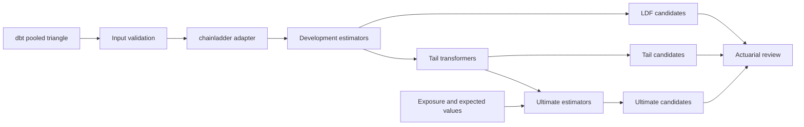

# Actuarial Engine v0.1

Auditable multi-line actuarial candidate engine backed by the official
`chainladder` Python package.

## Current Status

All actuarial calculations use `chainladder 0.10.x`. The project does not
implement separate versions of LDF averaging, regression, tail fitting, Chain
Ladder, Mack, BF, Cape Cod, Benktander, or Expected Loss formulas.

The platform code remains responsible for:

- validating and normalizing warehouse inputs;
- converting pandas rows to `chainladder.Triangle` objects;
- configuring package estimators;
- formatting package outputs into governed candidate tables;
- reporting unavailable methods without failing the entire run;
- attaching run, engine, and calculation-library versions;
- reading and writing Snowflake data safely.

## Architecture



dbt owns source standardization, cumulative financial definitions, triangle
construction, exposure aggregation, development-pool mapping, and warehouse
tests. The engine owns package configuration and governed result handling.

## Package Layout

```text
actuarial_engine/
|-- chainladder_adapter.py
|-- config.py
|-- triangle.py
|-- validation.py
|-- development.py
|-- tail.py
|-- ultimate.py
|-- result_formatter.py
|-- io.py
|-- run_modeling.py
|-- pyproject.toml
|-- sql/create_output_tables.sql
`-- tests/
```

`chainladder_adapter.py` is the only package integration boundary. It builds
`Triangle` objects, fits development and tail estimators, constructs
`sample_weight` triangles, and extracts package results.

## Inputs

### Pooled cumulative triangle

Source:
[`int_loss_triangle_pooled.sql`](../data_pipeline/models/intermediate/actuarial/development/int_loss_triangle_pooled.sql)

Grain:

```text
triangle_grain
+ development_pool_id
+ accident_period
+ development_age_months
```

Supported measures:

| Measure | Warehouse value |
| --- | --- |
| `paid` | `cumulative_paid_loss` |
| `paid_and_expense` | Paid loss plus paid expense |
| `incurred` | `cumulative_incurred_loss` |
| `reported_count` | `cumulative_reported_claim_count` |

The adapter supplies `accident_period` as origin, `valuation_date` as
development, and `cumulative_value` as the Triangle value column.

### Exposure input

Source:
[`int_development_exposure.sql`](../data_pipeline/models/intermediate/actuarial/inputs/int_development_exposure.sql)

It aligns earned exposure and premium with development pool and accident period.
Earned premium is the default Cape Cod `exposure_base`. The model is restricted
to the configured dbt `as_of_date`.

### Expected-value input

BF, Benktander, and Expected Loss require a governed expected value:

```text
development_pool_id
accident_period
triangle_grain       optional
measure_type          optional
exposure_base         required for Cape Cod
expected_loss_ratio   optional when expected_value exists
expected_value        required for BF, Benktander, and Expected Loss
```

When expected value is represented by exposure and an expected ratio, the input
adapter creates the package `sample_weight` value before model execution. Missing
or duplicate assumptions are rejected or reported explicitly.

## Package Mapping

### Development

| Platform method | Package estimator |
| --- | --- |
| `simple_average` | `Development(average="simple", n_periods=-1)` |
| `volume_weighted` | `Development(average="volume", n_periods=-1)` |
| `recent_3_weighted` | `Development(average="volume", n_periods=3)` |
| `regression` | `Development(average="regression", n_periods=-1)` |

Observed ratios come from `Triangle.link_ratio`; selected factors come from the
fitted estimator's `ldf_` attribute. The platform still enforces minimum sample
requirements for recent-three and regression candidates.

### Tail

| Platform method | Package transformer |
| --- | --- |
| `none` | No transformer |
| `constant` | `TailConstant` |
| `curve` | `TailCurve(curve="exponential")` |
| `bondy` | `TailBondy` |

Tail factors and diagnostics come from `tail_`, `slope_`, `intercept_`, and
`b_`. `bondy_earliest_age=None` uses package-default classic Bondy behavior;
setting an earlier age enables its generalized Bondy fit.

### Ultimate

| Platform method | Package estimator | Required additional input |
| --- | --- | --- |
| `chainladder` | `Chainladder` | None |
| `mack_chainladder` | `MackChainladder` | Volume-weighted development |
| `bornhuetter_ferguson` | `BornhuetterFerguson` | Expected-value sample weight |
| `cape_cod` | `CapeCod` | Exposure sample weight |
| `benktander` | `Benktander` | Expected-value sample weight |
| `expected_loss` | `ExpectedLoss` | Expected-value sample weight |

Ultimate and IBNR values are read directly from `ultimate_` and `ibnr_`. Mack
uncertainty comes from `mack_std_err_`. Cape Cod's fitted ratio comes from
`apriori_`.

## Method Availability

Every requested combination creates an output row:

| Status | Meaning |
| --- | --- |
| `AVAILABLE` | The package fit and all platform requirements passed. |
| `AVAILABLE_WITH_WARNING` | A package point estimate exists with a documented limitation. |
| `NOT_AVAILABLE` | Required data, pattern, or estimator conditions were missing. |

Examples include `MISSING_EXPECTED_VALUE`, `MISSING_EXPOSURE_BASE`,
`MACK_REQUIRES_VOLUME_WEIGHTED_DEVELOPMENT`, and package exception messages
prefixed with `CHAINLADDER_`.

## Default Candidate Grid

```text
grain: annual
measure: incurred
development: simple_average, volume_weighted, recent_3_weighted
tail: none, curve
ultimate: chainladder, mack_chainladder, bornhuetter_ferguson, cape_cod
```

Regression, constant tail, Bondy, Benktander, and Expected Loss are implemented
but opt-in to control candidate volume.

## Python API

```python
from datetime import date
import pandas as pd

from actuarial_engine import EngineConfig, run_modeling

result = run_modeling(
    pd.read_csv("triangle.csv"),
    config=EngineConfig(as_of_date=date(2023, 12, 31)),
    expected_input=pd.read_csv("expected_input.csv"),
    model_run_id="2023-12-31-annual-reserving",
)
```

The result contains observations, LDF candidates, tail candidates, ultimate
candidates, and diagnostics.

## Installation and Tests

```bash
python -m pip install -e "./actuarial_engine[test]"
python -m pytest -c actuarial_engine/pyproject.toml \
  actuarial_engine/tests -q -s -p no:cacheprovider
```

The runtime dependency is pinned to the compatible `chainladder>=0.10,<0.11`
API range.

## CLI

Local CSV execution:

```bash
python -m actuarial_engine.run_modeling \
  --as-of-date 2023-12-31 \
  --triangle-csv path/to/triangle.csv \
  --expected-input-csv path/to/expected_input.csv \
  --no-write
```

Omitting `--triangle-csv` uses the Snowflake repository.

## Snowflake Outputs

Create tables with
[`create_output_tables.sql`](sql/create_output_tables.sql).

Outputs:

- `ACTUARIAL_LDF_OBSERVATION`
- `ACTUARIAL_LDF_CANDIDATE`
- `ACTUARIAL_TAIL_CANDIDATE`
- `ACTUARIAL_MODEL_CANDIDATE`
- `ACTUARIAL_MODEL_DIAGNOSTIC`

Every record includes both platform and calculation dependency provenance:

```text
model_run_id
as_of_date
engine_name
engine_version
calculation_library
calculation_library_version
created_at
```

The repository uses private-key authentication and idempotent writes by stable
`MODEL_RUN_ID`.

## Governance Boundary

Package results are candidates, not actuarial selections. The planned review
workflow independently selects:

1. age-level LDFs;
2. a tail factor;
3. an ultimate method or manual ultimate by accident period.

Downstream reporting should consume approved selections rather than candidate
tables directly.

## Current Limitations

- Selection tables and the staged review workflow are not yet implemented.
- Airflow does not yet include the engine task or review checkpoint.
- The Snowflake adapter has not been tested against the live project account.
- The adapter currently configures exponential `TailCurve` only.
- Cape Cod trend and decay remain at package defaults.
- A governed Snowflake expected-value table is still needed for BF, Benktander,
  and Expected Loss without a CSV input.

## References

- [Chainladder-Python Triangle documentation](https://chainladder-python.readthedocs.io/main/library/generated/chainladder.Triangle.html)
- [Chainladder-Python Development documentation](https://chainladder-python.readthedocs.io/main/library/generated/chainladder.Development.html)
- [Chainladder-Python method guide](https://chainladder-python.readthedocs.io/main/user_guide/methods.html)
- [Chainladder-Python tail guide](https://chainladder-python.readthedocs.io/main/user_guide/tails.html)
