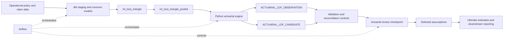

# Actuarial Engine

> **Current implementation:** See
> [CURRENT_IMPLEMENTATION.md](CURRENT_IMPLEMENTATION.md) for the implemented
> development, tail, Chain Ladder, Mack, BF, Cape Cod, Benktander, and Expected
> Loss engine. The specification below is retained as the original LDF migration
> baseline and historical design record.

## v0.1 Design Specification: LDF Candidate Engine

> **Implementation status:** Design specification. The dbt triangle models already
> exist, but the Python package, Snowflake output tables, and Airflow engine task
> described here are planned work. Existing SQL calculations remain the reference
> implementation until Python parity tests pass.

## 1. Purpose

The actuarial engine is the calculation layer between governed analytical data
and actuarial review. Its first release converts cumulative loss triangles into
auditable age-to-age observations and loss development factor (LDF) candidates.

The engine is intended to:

- keep actuarial algorithms separate from data transformation and orchestration;
- provide reusable calculations across personal auto and commercial property;
- make every result reproducible by valuation date, code version, and model run;
- preserve the distinction between model-generated candidates and selected
  actuarial assumptions;
- support automated testing, controlled reruns, and human review checkpoints.

The engine does not replace dbt. dbt remains responsible for standardizing raw
data, applying common insurance definitions, building triangles, and enforcing
warehouse-level data quality. The Python engine owns actuarial calculation logic
that benefits from reusable functions, explicit algorithms, and richer tests.

## 2. v0.1 Scope

### Included

- Validate the pooled cumulative triangle input.
- Build exact adjacent-period link-ratio observations.
- Calculate candidates for paid loss, incurred loss, and reported claim count.
- Support monthly, quarterly, half-year, and annual triangle grains.
- Calculate simple-average, volume-weighted, and recent-three-period
  volume-weighted candidates.
- Attach run, valuation, engine-version, and creation metadata.
- Support dry-run execution and controlled Snowflake writes.
- Provide unit, integration, data-contract, and SQL-to-Python parity tests.

### Not included

- Final LDF selections or approval decisions.
- Tail-factor selection.
- Cumulative development factors or ultimate loss estimates.
- Chain Ladder, Bornhuetter-Ferguson, or Cape Cod estimates.
- Pricing rating engine logic.
- UI, API, or report implementation.
- Replacement of source, staging, or triangle data-quality controls in dbt.

These capabilities can be added after v0.1 produces stable, reconciled LDF
candidates.

## 3. System Context



The engine consumes the pooled triangle produced by
[`int_loss_triangle_pooled.sql`](../data_pipeline/models/intermediate/actuarial/development/int_loss_triangle_pooled.sql).
It does not read raw policy or claim transactions directly.

## 4. Responsibility Boundaries

| Component | Responsibility |
| --- | --- |
| dbt | Standardize source data, derive cumulative measures, construct triangles, assign development pools, and run warehouse data tests. |
| Actuarial engine domain layer | Validate calculation prerequisites, pair development ages, calculate observations, and generate candidates. |
| Actuarial engine I/O layer | Read approved Snowflake inputs and write versioned output records. |
| Airflow | Pass run context, enforce dependencies, retry tasks, record task status, and pause at review checkpoints. |
| Actuarial reviewer | Compare candidates, document judgment, and approve or reject selected assumptions. |
| Downstream models | Consume approved selections, not unreviewed candidate results. |

The core calculation functions must not contain Snowflake connection code,
Airflow context, environment-variable access, or approval workflow logic. They
accept data frames and configuration values and return data frames.

## 5. Proposed Package Layout

```text
actuarial_engine/
|-- README.md
|-- pyproject.toml
|-- src/
|   `-- actuarial_engine/
|       |-- __init__.py
|       |-- config.py
|       |-- development.py
|       |-- io.py
|       `-- run_development.py
`-- tests/
    |-- unit/
    |   `-- test_development.py
    |-- integration/
    |   `-- test_snowflake_io.py
    `-- parity/
        `-- test_sql_python_parity.py
```

Proposed module responsibilities:

| Module | Responsibility |
| --- | --- |
| `config.py` | Engine settings, supported grains, measures, methods, and environment configuration. |
| `development.py` | Pure validation, observation-building, and candidate calculations. |
| `io.py` | Snowflake reads, writes, table contracts, and transaction handling. |
| `run_development.py` | CLI entry point and run-level coordination. |

## 6. Input Data Contract

### Source model

`INT_LOSS_TRIANGLE_POOLED`

### Grain

One row per:

```text
triangle_grain
+ development_pool_id
+ accident_period
+ development_age_months
```

`development_pool_id` is the primary segmentation interface between the dbt
feature layer and the actuarial engine. The engine does not need to know whether
the underlying risk unit is a vehicle or a property location. This keeps the
algorithm reusable across lines of business.

### Required columns

| Column | Expected type | Description |
| --- | --- | --- |
| `TRIANGLE_GRAIN` | string | `monthly`, `quarterly`, `half_year`, or `annual`. |
| `DEVELOPMENT_POOL_ID` | string | Governed development segmentation identifier. |
| `POOL_LEVEL` | string | Describes the pooling hierarchy used by dbt. |
| `LINE_OF_BUSINESS` | string | Business line represented by the development pool. |
| `ACCIDENT_PERIOD` | date | Start date of the accident period. |
| `DEVELOPMENT_AGE_MONTHS` | integer | Months from accident period to valuation. |
| `VALUATION_DATE` | date | Valuation date represented by the triangle row. |
| `CUMULATIVE_REPORTED_CLAIM_COUNT` | numeric | Cumulative reported claim count. |
| `CUMULATIVE_PAID_LOSS` | numeric | Cumulative paid indemnity loss. |
| `CUMULATIVE_CASE_RESERVE` | numeric | Cumulative case loss reserve. |
| `CUMULATIVE_PAID_EXPENSE` | numeric | Cumulative paid loss-adjustment expense. |
| `CUMULATIVE_CASE_EXPENSE` | numeric | Cumulative case expense reserve. |
| `CUMULATIVE_RECOVERY` | numeric | Cumulative salvage, subrogation, and other recovery. |
| `CUMULATIVE_INCURRED_LOSS` | numeric | Cumulative incurred amount under the governed dbt definition. |

### Grain configuration

| Triangle grain | Adjacent development step |
| --- | ---: |
| `monthly` | 1 month |
| `quarterly` | 3 months |
| `half_year` | 6 months |
| `annual` | 12 months |

### Input invariants

Before calculation, the engine must confirm that:

- all required columns exist;
- the input key is unique;
- supported grains are used;
- development ages are non-negative integers;
- each observation uses an exact adjacent age for its grain;
- calculation measures are numeric;
- the input contains no null segmentation or period keys;
- valuation dates do not exceed the requested `AS_OF_DATE`;
- the requested valuation date is consistent with the dbt model run;
- no duplicate pooled rows would create a many-to-many age pairing.

A missing adjacent age is not silently replaced by the next available age. That
pair is omitted and reported in run diagnostics.

## 7. Supported Measures

| Measure | Input column | v0.1 use |
| --- | --- | --- |
| `paid` | `CUMULATIVE_PAID_LOSS` | Paid loss development. |
| `incurred` | `CUMULATIVE_INCURRED_LOSS` | Incurred loss development. |
| `reported_count` | `CUMULATIVE_REPORTED_CLAIM_COUNT` | Reported claim-count development. |

The current SQL observation workflow also contains a paid-loss-plus-expense
measure. v0.1 deliberately defers that measure unless SQL parity is required for
the first migration. It can be added as a configured measure without changing
the observation or candidate table design.

## 8. LDF Observation Algorithm

For every measure and development group, the engine pairs an accident period at
age `d` with the same accident period at exactly `d + step`.

For a valid pair:

```text
link_ratio = cumulative_value_at_to_age / cumulative_value_at_from_age
```

The ratio is calculated only when the from-age value is greater than zero.
Zero or invalid denominators are excluded and recorded in diagnostics; the
engine does not replace them with `1.0`.

Observation grouping dimensions:

```text
triangle_grain
+ development_pool_id
+ pool_level
+ line_of_business
+ accident_period
+ measure
+ from_age_months
+ to_age_months
```

Core function contract:

```python
def build_ldf_observations(
    triangle: pd.DataFrame,
    *,
    as_of_date: date,
) -> pd.DataFrame:
    """Return exact adjacent-age LDF observations for supported measures."""
```

## 9. Candidate Methods

Candidates are aggregated separately for every triangle grain, development
pool, measure, and age pair.

### Simple average

```text
candidate_ldf = average(link_ratio)
```

Each eligible accident period receives equal weight.

### Volume weighted

```text
candidate_ldf = sum(to_age_value) / sum(from_age_value)
```

This method gives more influence to accident periods with larger from-age
volume.

### Recent-three volume weighted

```text
candidate_ldf = sum(to_age_value for latest 3 accident periods)
              / sum(from_age_value for latest 3 accident periods)
```

The engine orders eligible observations by accident period and uses the latest
three. The output records the actual observation count. If fewer than the
configured minimum are available, the candidate is marked unavailable rather
than being defaulted.

Core function contract:

```python
def calculate_ldf_candidates(
    observations: pd.DataFrame,
    *,
    recent_period_count: int = 3,
) -> pd.DataFrame:
    """Aggregate observations into versioned LDF candidates."""
```

## 10. Output Data Contracts

### `ACTUARIAL_LDF_OBSERVATION`

One row represents one accident-period observation for one measure and age
pair.

| Column | Description |
| --- | --- |
| `MODEL_RUN_ID` | Stable identifier for one engine execution. |
| `AS_OF_DATE` | Valuation cutoff supplied to the run. |
| `ENGINE_VERSION` | Semantic version of the calculation package. |
| `TRIANGLE_GRAIN` | Triangle period grain. |
| `DEVELOPMENT_POOL_ID` | Governed development pool. |
| `POOL_LEVEL` | Pooling hierarchy level. |
| `LINE_OF_BUSINESS` | Line of business. |
| `ACCIDENT_PERIOD` | Accident period used by the observation. |
| `MEASURE` | `paid`, `incurred`, or `reported_count`. |
| `FROM_AGE_MONTHS` | Beginning development age. |
| `TO_AGE_MONTHS` | Ending development age. |
| `FROM_VALUE` | Cumulative value at the beginning age. |
| `TO_VALUE` | Cumulative value at the ending age. |
| `LINK_RATIO` | `TO_VALUE / FROM_VALUE`. |
| `CREATED_AT` | UTC result-creation timestamp. |

Expected unique key:

```text
MODEL_RUN_ID
+ TRIANGLE_GRAIN
+ DEVELOPMENT_POOL_ID
+ ACCIDENT_PERIOD
+ MEASURE
+ FROM_AGE_MONTHS
+ TO_AGE_MONTHS
```

### `ACTUARIAL_LDF_CANDIDATE`

One row represents one candidate method for one measure and age pair.

| Column | Description |
| --- | --- |
| `MODEL_RUN_ID` | Stable identifier for one engine execution. |
| `AS_OF_DATE` | Valuation cutoff supplied to the run. |
| `ENGINE_VERSION` | Semantic version of the calculation package. |
| `TRIANGLE_GRAIN` | Triangle period grain. |
| `DEVELOPMENT_POOL_ID` | Governed development pool. |
| `POOL_LEVEL` | Pooling hierarchy level. |
| `LINE_OF_BUSINESS` | Line of business. |
| `MEASURE` | Development measure. |
| `FROM_AGE_MONTHS` | Beginning development age. |
| `TO_AGE_MONTHS` | Ending development age. |
| `METHOD` | Candidate method identifier. |
| `CANDIDATE_LDF` | Calculated age-to-age factor. |
| `OBSERVATION_COUNT` | Number of observations used. |
| `IS_AVAILABLE` | Whether minimum calculation requirements were met. |
| `CREATED_AT` | UTC result-creation timestamp. |

Expected unique key:

```text
MODEL_RUN_ID
+ TRIANGLE_GRAIN
+ DEVELOPMENT_POOL_ID
+ MEASURE
+ FROM_AGE_MONTHS
+ TO_AGE_MONTHS
+ METHOD
```

Candidate tables contain model-generated alternatives. They must not be treated
as approved assumptions or consumed directly by final ultimate calculations.

## 11. Run Identity and Reproducibility

Every execution receives a `MODEL_RUN_ID`. A retry of the same logical Airflow
task must reuse that ID so writes are idempotent. Generating a new ID during a
retry would create a second logical run and should be avoided.

Required run metadata:

- `MODEL_RUN_ID`;
- `AS_OF_DATE`;
- `ENGINE_VERSION`;
- `CREATED_AT` in UTC.

Recommended production metadata:

- Git commit SHA;
- dbt invocation ID;
- source relation and source maximum ingestion timestamp;
- development-pool configuration version;
- calculation configuration hash;
- Airflow DAG run ID;
- run status and row counts;
- warning and exclusion counts.

Together, these values answer: which data, definitions, configuration, code,
and execution produced a result?

## 12. Assumption Governance and Review

LDF candidates and LDF selections are separate data assets.

1. The engine generates candidates using repeatable algorithms.
2. Automated controls reconcile row counts, formulas, and expected ranges.
3. Airflow creates or waits at a review checkpoint.
4. An actuary compares candidates and documents the rationale for a selection.
5. The approved selection is stored with author, timestamp, status, effective
   valuation date, source candidate, and optional override reason.
6. Ultimate calculations consume only an approved assumption version.

This separation preserves actuarial judgment without embedding decisions in
code or overwriting model output.

## 13. Snowflake I/O and Security

The I/O adapter should use the same private-key authentication pattern as the
dbt project. No password or private-key contents should be committed to source
control.

Expected environment variables:

```text
SNOWFLAKE_ACCOUNT
SNOWFLAKE_USER
SNOWFLAKE_ROLE
SNOWFLAKE_DATABASE
SNOWFLAKE_WAREHOUSE
SNOWFLAKE_SCHEMA
SNOWFLAKE_PRIVATE_KEY_PATH
```

I/O requirements:

- allowlist database, schema, relation, and grain identifiers;
- parameterize data values such as `AS_OF_DATE` and `MODEL_RUN_ID`;
- close connections in success and failure paths;
- write observations and candidates in one controlled transaction where
  supported;
- use merge or delete-and-insert semantics keyed by `MODEL_RUN_ID`;
- fail the task if only one output table is written;
- record source and output row counts.

## 14. Proposed CLI

After the package is implemented, a local dry run should use:

```bash
python -m actuarial_engine.run_development \
  --as-of-date 2023-12-31 \
  --no-write
```

A controlled warehouse write should use:

```bash
python -m actuarial_engine.run_development \
  --as-of-date 2023-12-31 \
  --model-run-id "<airflow-provided-run-id>"
```

Recommended options:

```text
--as-of-date DATE        Required valuation cutoff.
--model-run-id UUID      Stable run ID; required for orchestrated writes.
--triangle-grain VALUE   Optional grain filter.
--pool-id VALUE          Optional development-pool filter.
--no-write               Calculate and validate without persistence.
--fail-on-warning        Treat data exclusions as run failures.
```

## 15. Airflow Integration

Recommended task sequence:

```text
dbt_build_triangle
    -> validate_triangle_contract
    -> calculate_ldf_candidates
    -> test_engine_outputs
    -> publish_review_packet
    -> actuarial_review_checkpoint
    -> publish_approved_selections
    -> calculate_ultimate_estimates
```

Airflow should provide the valuation date and stable model run ID. The engine
should not infer a valuation date from the current system date because that
would make historical reruns ambiguous.

On failure:

- dbt failures prevent the engine from starting;
- engine validation failures write no candidate output;
- transient Snowflake failures can be retried with the same model run ID;
- review rejection does not overwrite candidates;
- downstream ultimate tasks remain blocked until an approved selection exists.

## 16. Validation and Testing Strategy

### Unit tests

- exact monthly, quarterly, half-year, and annual age pairing;
- simple-average formula;
- volume-weighted formula;
- recent-three observation selection;
- separate calculations by pool, grain, LOB, measure, and age pair;
- zero and null denominator handling;
- missing adjacent-age handling;
- duplicate input-key rejection;
- unavailable candidate behavior for insufficient observations;
- stable output column names and data types.

### Integration tests

- read a controlled Snowflake fixture;
- apply valuation-date filtering;
- write both output tables;
- rerun the same model run without duplication;
- roll back or fail cleanly on partial writes;
- verify private-key connection configuration.

### SQL-to-Python parity tests

Before Python becomes the primary implementation, compare its observations and
candidates with the existing SQL calculations at the same grain and scope.
Tests should compare:

- observation keys;
- from and to cumulative values;
- link ratios;
- candidate values;
- observation counts;
- excluded-record counts.

Numeric comparisons should use a documented tolerance. Differences caused by
intentional scope changes, such as pooled versus unpooled calculations or the
deferred paid-plus-expense measure, must be explained rather than hidden by a
wide tolerance.

### Warehouse data tests

The persisted outputs should have dbt tests for:

- non-null run and calculation keys;
- unique composite keys;
- accepted measure and method values;
- `TO_AGE_MONTHS > FROM_AGE_MONTHS`;
- non-negative observation counts;
- non-null candidate values when `IS_AVAILABLE = true`;
- relationship from candidate run IDs to a model-run registry;
- relationship from selected assumptions to valid candidates or a documented
  manual override.

## 17. Acceptance Criteria

v0.1 is complete only when:

- the package installs in a clean environment;
- all supported grains and measures pass unit tests;
- dry-run execution produces deterministic outputs;
- Python results reconcile with the agreed SQL reference scope;
- Snowflake writes are idempotent by model run ID;
- dbt tests pass on both output tables;
- Airflow can execute and retry the engine task safely;
- candidate output cannot bypass the review and selection layer;
- documentation identifies the exact input and output contracts.

## 18. Migration Plan

### Phase 1: Freeze the contract

- Confirm the pooled triangle grain and column definitions.
- Confirm supported measures and development grains.
- Add dbt contract tests required by the engine.

### Phase 2: Implement pure calculations

- Implement `validate_triangle`.
- Implement `build_ldf_observations`.
- Implement `calculate_ldf_candidates`.
- Add deterministic unit fixtures and tests.

### Phase 3: Reconcile with SQL

- Run Python in no-write mode.
- Compare results against the current SQL reference.
- Resolve unexplained differences before migration.

### Phase 4: Persist and orchestrate

- Create Snowflake output tables.
- Implement private-key I/O and idempotent writes.
- Add output sources and tests to dbt.
- Add the engine task and retry behavior to Airflow.

### Phase 5: Add review and downstream methods

- Publish candidate comparison views.
- Connect candidates to versioned selections and approvals.
- Add selected LDFs, cumulative development factors, tails, and ultimate methods.

## 19. Multi-Line Design

The shared engine is intentionally line-agnostic. Line-specific logic remains in
the upstream LOB modules and development-pool mapping.

Examples:

- Personal auto can pool by coverage, state, vehicle segment, or another
  approved pricing dimension.
- Commercial property can pool by coverage, construction class, protection
  class, geography, or catastrophe treatment.
- Both lines produce the same canonical cumulative measures and pooled triangle
  contract.
- The engine applies the same age-pairing and candidate algorithms after pooling.

This structure avoids a large `if line_of_business == ...` calculation module.
New lines are onboarded by mapping their source features into the common model
and configuring development pools, not by duplicating the LDF engine.

## 20. Design Decisions

### Why Python and pandas first?

The initial algorithms are transparent and small enough to express directly in
pandas. This makes the formulas easy to explain, test, and compare with SQL. A
library such as `chainladder` can later be used as an independent cross-check or
for more advanced methods, rather than hiding the first implementation behind a
framework.

### Why keep triangle construction in dbt?

Triangle construction depends on governed claim definitions, valuation logic,
pool mappings, and warehouse data controls. Keeping it in dbt preserves lineage
from raw transactions to cumulative analytical data. The engine then receives a
stable actuarial contract instead of reimplementing warehouse transformations.

### Why separate candidates from selections?

A candidate is a reproducible model result. A selection is an actuarial decision
that may incorporate credibility, business context, catastrophe treatment, and
professional judgment. Keeping them separate makes both the calculation and the
decision auditable.

## 21. Future Roadmap

- Add paid-loss-plus-expense observations.
- Add configurable candidate windows and exclusions.
- Add tail-factor candidates and selections.
- Derive selected cumulative development factors.
- Implement Chain Ladder ultimate estimates.
- Add Bornhuetter-Ferguson and Cape Cod methods.
- Cross-check selected results with the `chainladder` package.
- Add model-run and assumption-governance APIs.
- Add an actuarial review UI for triangle, candidate, selection, and approval
  workflows.
- Publish approved results to Tableau or Power BI reporting marts.

## 22. Terminology

| Term | Meaning |
| --- | --- |
| Observation | One accident-period age-to-age ratio. |
| Candidate | Algorithmically aggregated LDF proposed for review. |
| Selection | Actuary-approved assumption used downstream. |
| Development pool | Governed group of risks expected to share a development pattern. |
| Model run | One reproducible engine execution for a valuation date and configuration. |
| Review checkpoint | Workflow state that prevents unapproved candidates from reaching downstream calculations. |

